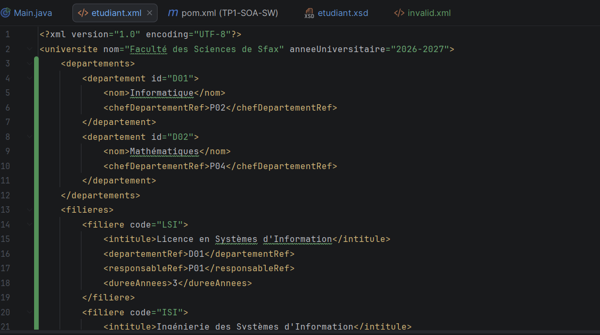
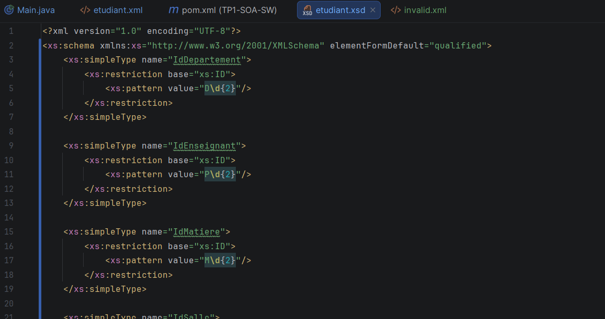
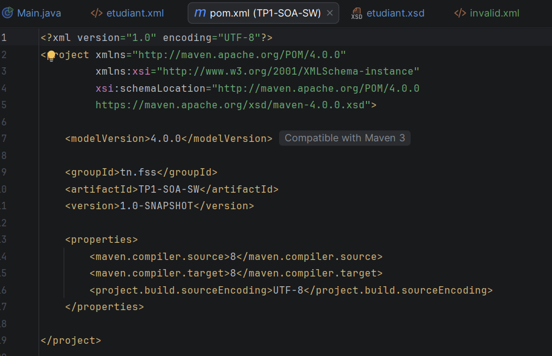
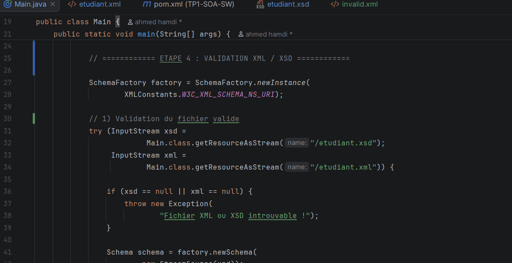
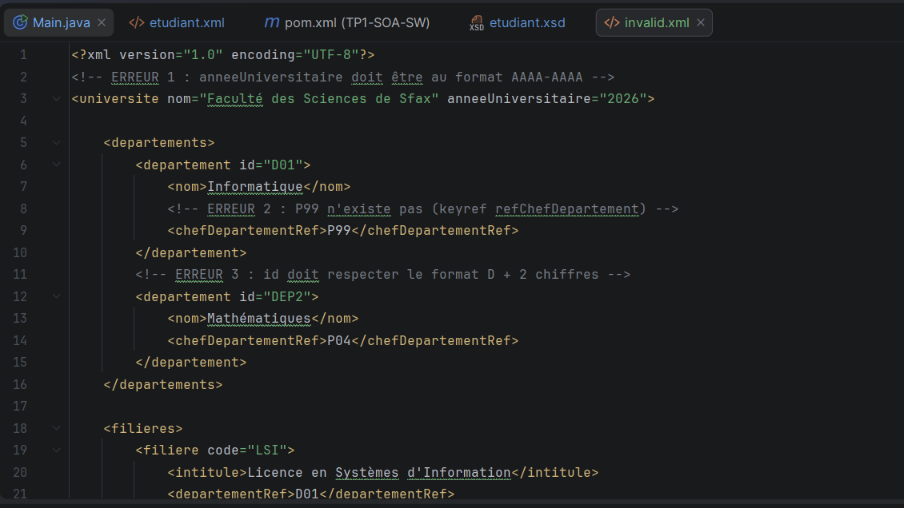
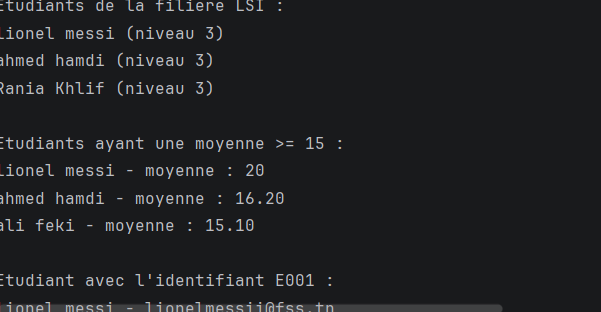
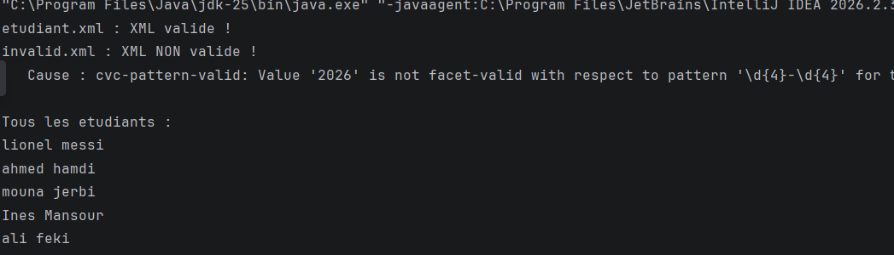

# TP1-SOA-SW – Modélisation XML et Interrogation XPath avec Maven en Java

[Prénom NOM] – LSI3 – Architecture SOA et services web

# Activité : Modélisation XML, validation XSD et requêtes XPath

## Étape 1 : Choix du domaine et modélisation XML

Le domaine choisi est la gestion d'une université. Le fichier
etudiant.xml a pour racine l'élément universite (attributs nom et anneeUniversitaire =
2026-2027). Il contient les départements (D01 Informatique, D02 Mathématiques), les
filières (LSI, ISI) et les étudiants. Les liens entre entités se font par références
(chefDepartementRef, departementRef, responsableRef).

## Étape 2 : Création du schéma XSD

Le fichier etudiant.xsd décrit la structure attendue du document. Il définit des types
simples avec des contraintes pattern :
- IdDepartement : D suivi de 2 chiffres (ex. D01)
- IdEnseignant : P suivi de 2 chiffres (ex. P01)
- IdMatiere : M suivi de 2 chiffres (ex. M01)

Interprétation : ces types restreignent le format des identifiants. Un identifiant
qui ne respecte pas le motif est rejeté lors de la validation.

## Étape 3 : Création du projet Maven

Création du projet Maven TP1-SOA-SW (groupId tn.fss, version 1.0-SNAPSHOT) dans IntelliJ IDEA.
Le pom.xml configure Java 8 et l'encodage UTF-8. Les API javax.xml (JAXP, XPath) font
partie du JDK : aucune dépendance externe n'est nécessaire.

## Étape 4 : Implémentation de la validation XML/XSD

La classe Main utilise SchemaFactory (avec XMLConstants.W3C_XML_SCHEMA_NS_URI) pour
charger etudiant.xsd, puis un Validator pour valider le fichier XML. Si le XSD ou le
XML est introuvable, une exception est levée.

### Fichier invalide

Le fichier invalid.xml contient volontairement 3 erreurs :
1. anneeUniversitaire="2026" au lieu du format AAAA-AAAA ;
2. P99 n'existe pas (violation du keyref refChefDepartement) ;
3. id="DEP2" ne respecte pas le format D + 2 chiffres.

### Résultat de la validation

Interprétation : etudiant.xml est déclaré « XML valide ! ». invalid.xml est « XML NON
valide ! » avec la cause : cvc-pattern-valid : la valeur '2026' ne respecte pas le motif
\d{4}-\d{4}. Le validateur détecte donc bien les erreurs du fichier invalide.

## Étape 5 : Interrogation XPath
La classe Main utilise XPathFactory et XPathExpression pour interroger etudiant.xml.

| Requête | Expression XPath |
|---|---|
| Tous les étudiants | //etudiant/nom |
| Étudiants de la filière LSI | //etudiant[filiere='LSI'] |
| Étudiants avec moyenne >= 15 | //etudiant[moyenne >= 15] |
| Étudiant d'identifiant E001 | //etudiant[@id='E001'] |

## Étape 6 : Test et vérification

Interprétation :
- Filière LSI : lionel messi, ahmed hamdi, Rania Khlif (niveau 3).
- Moyenne >= 15 : lionel messi (20), ahmed hamdi (16.20), ali feki (15.10).
- Identifiant E001 : lionel messi – lionelmessii@fss.tn.

Les deux fonctionnalités (validation XML/XSD et interrogation XPath) fonctionnent
correctement.

## Exécution
mvn clean compile
mvn exec:java -Dexec.mainClass="Main"
Ou directement dans IntelliJ : clic droit sur Main.java → Run.